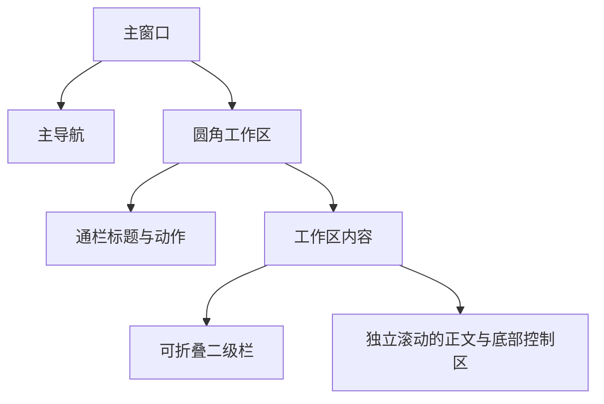

# Voice2Text 桌面工作区改造 - Plan

## Goal Capsule

- **目标。** 让 Voice2Text 的主导航、列表和正文呈现与 Media Studio 相近的工作区层次。用户选中音频后，可以从同一条顶栏识别当前文件并找到导出。
- **做法。** 在现有 Electron Renderer 内采用 App Shell 8 的布局组合。见 KTD1。
- **依据。** 用户偏好 Media Studio 的样式，会话示意图表达拟议布局。现有源码和项目规范负责界定页面状态、交互和业务边界。
- **交付。** 四个依赖有序的单元组成一次变更，供用户审阅。用户授权实施后，由实施者完成代码和验证。
- **停止条件。** 发现需要改变业务合同、独立录制窗口或应用权限时，先把冲突带回评审。视觉验证按仓库的本次任务授权执行。

## Product Contract

### Summary

主导航独立于工作区。列表和正文共享一个有留白的圆角外框，设置页和已选音频使用通栏标题。设置表单与音频详情随新外框调整排版。

### Problem Frame

目前主导航、二级栏和正文贴着窗口边缘排列。设置分类和当前页面各有一处标题。音频详情另有大标题、滚动后出现的小标题和悬浮导出，导致页面与 Media Studio 的通栏工作区观感差异明显。两边的主题和常用控件已有相同基础。

### Requirements

**工作区和导航**

- R1. 主窗口采用 63px 主导航，圆角工作区上、右、下各留 8px，使用 14px 圆角、1px 细边框和无阴影表面。工作区顶栏高 50px，跨过二级栏和正文。
- R2. 二级栏默认 300px，使用现有 260–380px 请求范围，在可用宽度不足时缩窄以给正文保留至少 480px。保留指针和键盘调宽、折叠、Esc、焦点回归，以及各入口各自的折叠偏好。
- R3. 音频、互联、消息和设置继续使用现有入口、路由与动作。录制专注、启动等待和弹窗仍使用各自的导航可见性与禁用条件。

**设置与音频**

- R4. 设置顶栏显示当前分类，例如「设置 › 通用」。通用、录制、本地模型和云端模型使用一致的内容边距与分组行排版，标签和说明在左，控件在右，空间不足时可换行。
- R5. 选中音频时，顶栏显示一个可编辑的文件标题和导出入口。正文可编辑描述，转写文本、AI 总结、知识库和底部播放器保留各自的交互。
- R6. 首次使用时呈现整面导入和录制入口。有列表但未选中时呈现列表和正文的选择提示。录制详情继续呈现现有标题、状态、返回或关闭动作及控制区。各状态的顶栏和二级栏由页面状态决定。

### Scope Boundaries

实施范围为 `apps/desktop-electron` 的主窗口 Renderer、直接相关的测试和现行布局说明。录制、转写、播放、导出、权限、存储及 IPC 沿用现有合同。Flutter、Media Studio 参考仓库和独立悬浮录制窗属于各自的产品或窗口范围。

### Sources

- 用户提供的样式偏好和会话中的「当前布局 / 改造示意」对照。示例文件名、时长和录音按钮状态是示意内容。
- 同级仓库的 `../media-studio/apps/desktop/DESIGN.md` 记录 App Shell 8 规格。采用其外框和通栏构图，当前项目二级栏宽度由 R2 决定。
- 现有行为以 `apps/desktop-electron/src/renderer/App.tsx` 和 `apps/desktop-electron/src/renderer/features/shell/context-pane-contract.ts` 为准。空态与外框的独立规则见 [空态专题](../separate-empty-state-component-scope-from-shell-chrome.md)。

## Planning Contract

### Assumptions

300px 默认宽度、保留拖拽、音频详情使用可编辑的通栏标题，都是根据示意图提出的实施方案。当前未选中音频时的顶栏显隐沿用现状。

### Key Technical Decisions

- KTD1. **外框与页面状态分开。** 复用本地 `SidebarInset` 和 `AppShellFrame`。主导航与工作区为并列区域，工作区内按顶栏、内容区布置。上下文面板、正文滚动区、提示和页脚继续使用现有组件与状态所有者。
- KTD2. **一个宽度状态。** 把二级栏宽度定义为包含边框的宽度。尺寸上限在同一处扣除 63px 导航、8px 右侧留白和 2px 外框边线。在 880px 窗口时，计划上限为 327px。变宽后恢复原请求宽度。折叠按钮和拖拽手柄按同一分界线定位。
- KTD3. **音频详情提供顶栏内容。** 由 Shell 提供标题和动作挂载位，音频详情在自身组件树中保有标题草稿、保存、错误和焦点恢复。详情使用 Shell 顶栏时，只渲染这一组标题与导出控件。独立音频工作区继续使用页内标题。

### High-Level Technical Design

下面只表示区域关系。

| 状态 | 顶栏 | 二级栏与正文 |
| --- | --- | --- |
| 首次使用 | 隐藏 | 整面导入和录制入口 |
| 有音频，未选中 | 隐藏 | 音频列表和选择提示 |
| 已选音频 | 音频 › 当前文件，带导出 | 音频列表、详情标签、播放器 |
| 设置 | 设置 › 当前分类 | 设置分类与表单 |
| 互联和消息 | 由现有详情显隐条件决定 | 保留各自的列表、详情及返回动作 |
| 录制详情 | 现有录制标题和状态 | 正文与录制控制区，二级栏隐藏，主导航按录制模式显示 |

## Implementation Units

### U1. Frame and navigation

- **目标与依赖。** 落地工作区外框、导航、统一顶栏和二级栏布局。覆盖 R1–R3，作为 U2 和 U3 的前置。
- **涉及文件。** `apps/desktop-electron/src/renderer/features/shell/{app-shell-frame,context-pane-shell}.tsx`、`apps/desktop-electron/src/renderer/features/shell/{context-pane-contract,use-context-pane-width}.ts`、`apps/desktop-electron/src/renderer/components/{app-sidebar,nav-main,ui/sidebar}.tsx`、`apps/desktop-electron/src/renderer/App.tsx`。
- **做法。** 依 KTD1 和 KTD2 调整布局。拆开导航占位与二级栏占位，保留既有路由树、主题和弹窗层级。去掉常规页面在二级栏里重复的区块标题，保留列表工具栏、筛选、消息全部已读和底部操作。
- **用例。** `apps/desktop-electron/tests/unit/renderer/shell_test.tsx` 与 `apps/desktop-electron/tests/e2e/sidebar_navigation_test.ts` 覆盖路由、独立折叠偏好、焦点回归、录制专注和启动等待。用 `apps/desktop-electron/tests/unit/renderer/context_pane_width_test.tsx` 检查默认 300px、880px 视口钳制、加宽时恢复请求宽度、重载回到默认值及手柄键盘操作。用 `apps/desktop-electron/tests/unit/renderer/{companion_route,activity_center,capture_workspace}_test.tsx` 检查共用外框下的相关入口和焦点。实际像素位置由视觉用例验证。

### U2. Settings layout

- **目标与依赖。** 在 U1 的统一顶栏下，完成 R4。
- **涉及文件。** `apps/desktop-electron/src/renderer/App.tsx` 的 `SettingsContextPane`，`apps/desktop-electron/src/renderer/features/settings/{settings-page-section,appearance-settings-feature,recording-settings-feature,local-models-feature,ai-settings-feature}.tsx`，以及 `apps/desktop-electron/src/renderer/spacing.css`。
- **做法。** 利用现有设置分组和语义色，统一左侧分类列表的内缩、右侧页面边距和分组行的间距。把「外观」放入有标签、说明和色彩模式控件的分组行。让较长的模型或录制操作在窄空间换行。
- **用例。** 在 `apps/desktop-electron/tests/unit/renderer/shell_test.tsx` 检查分类切换和标题更新。用 `apps/desktop-electron/tests/unit/renderer/{appearance_theme,recording_settings,local_models,ai_settings}_test.tsx` 覆盖现有设置操作和标签关联。卡片与控件的实际排版由对应设置视觉用例确认。

### U3. Audio detail and capture states

- **目标与依赖。** 在 U1 的标题挂载位中完成 R5、R6，保持录制与播放器入口可达。
- **涉及文件。** `apps/desktop-electron/src/renderer/App.tsx`、`apps/desktop-electron/src/renderer/features/audios/{audio-route-feature,audio-workspace-feature}.tsx`，以及 Shell 中音频详情消费的标题和动作插槽。
- **做法。** 依 KTD3 复用编辑和导出逻辑。音频详情去掉大标题切换到小标题的旧布局，标签以正文滚动容器为参照吸顶。描述、保存错误和转写状态保留在详情区域。空态、录制详情和录制模式显隐规则集中在现有呈现判断处。
- **用例。** `apps/desktop-electron/tests/unit/renderer/{audio_workspace,audio_route,shell}_test.tsx` 检查已选音频只出现一个可编辑标题，覆盖标题取消、保存失败后反馈、快速切换时旧响应不影响新选择、导出仍针对选中文件，以及首用、未选中和录制详情的显示。用现有录制用例确认开始、恢复、结束及退出详情时控制区和焦点仍正确。滚动时的吸顶关系和底部遮挡由视觉用例验证。

### U4. Reference and regression coverage

- **目标与依赖。** 在 U1–U3 后更新现行说明与受影响的回归检查。
- **涉及文件。** `apps/desktop-electron/README.md`、`docs/architecture/electron-audio-context-shell.md`、`apps/desktop-electron/tests/visual/{renderer-shell,pane-spacing-alignment}.visual.spec.ts`。以现行规范归属决定是否同步 `docs/standards/electron-renderer.md`。
- **做法。** 更新现行的 Shell 规格及宽度约定。为 App Shell 8 增加当前几何与可达性断言，保留 App Shell 4 的历史参照来源。需要截图基准更新时，获得对该操作的明确授权后建立新基准。
- **用例。** 验证 1240×820 默认窗口与 880×620 最小窗口的工作区边界、顶栏跨度、二级栏折叠、正文最小宽度和无横向溢出。覆盖音频长标题、设置、明暗主题、录制详情与恢复弹窗的关键状态。用现有参考尺寸对照外框几何。

## Verification Contract

- 变更前后使用仓库规则路由，按实际文件与直接消费者确定验证范围。对改动文件执行 Prettier、ESLint 和 Electron 包类型检查，运行上述相关 Vitest 文件及导航消费者。按 [验证规范](../standards/verification.md) 去重。
- 取得当次视觉验证授权后，使用现有 Electron Playwright harness 运行受影响的具名用例。默认与最小尺寸覆盖布局变化，明暗状态覆盖主题相关部分。金图更新另按项目规则确认。
- 记录每个检查的覆盖范围与结果。源码检查、可访问性断言和渲染证据分别报告。

## Definition of Done

- 主窗口按 R1–R6 呈现。默认和最小尺寸下，折叠、调宽、标题编辑、导出、播放器与录制控件可操作。
- 现行布局说明与实现一致。旧布局兼容入口和历史基准的用途清楚，移除仅服务于被替换布局的重复代码。
- 受影响的非 GUI 检查通过。按获得的视觉授权记录渲染结果和覆盖限制。
